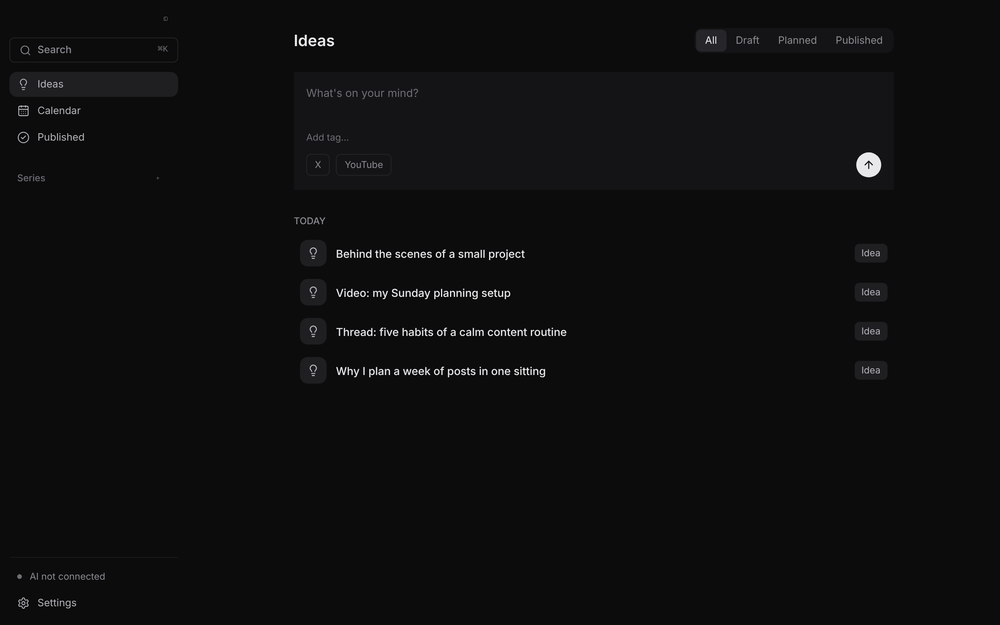
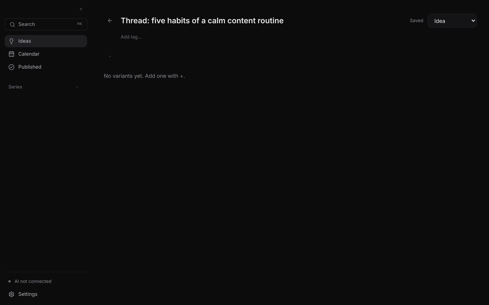
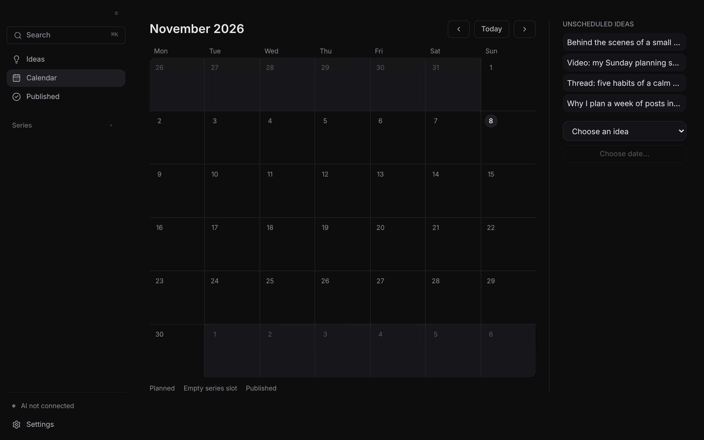

# Cadence

A calm, local-first planner for your posts and content series.

**Status:** pre-alpha. See the [roadmap](docs/build-plan.md#10-milestones-and-issues).

## Why

Most social media tools are built for teams. Cadence is for one person who wants a quiet place and a routine.

## Planned features

- Quick capture of ideas
- Platform-aware drafts (X threads, YouTube videos, …)
- Series with a publishing rhythm, and a calendar
- Bring your own AI, including Ollama
- Extensible platforms
- Local-first: your data stays on your machine

Cadence does not publish for you. It plans, drafts and reminds.

## Screenshots





Regenerate them with `pnpm screenshots` (browser mode, demo data).

## Install

Download the latest `.dmg` from the [Releases](../../releases) page, open it and drag Cadence to Applications. Builds are macOS only for now. Until releases are signed, macOS may ask you to confirm opening the app (right-click → Open).

A short [user guide](docs/guide.md) explains the main screens.

## Tech stack

Tauri 2, React, TypeScript, Vite, Tailwind CSS, SQLite. Decisions are recorded in [docs/adr](docs/adr).

## Development

Requires Node 22+, pnpm and (for the desktop shell) a Rust toolchain.

```bash
pnpm install
pnpm dev          # UI in a browser with in-memory browser adapters
pnpm typecheck
pnpm tauri dev    # desktop app (local machine only)
```

Linux needs `libwebkit2gtk-4.1-dev libgtk-3-dev libayatana-appindicator3-dev librsvg2-dev` to compile `src-tauri`.

## Built with Claude Code

Cadence is developed with Claude Code in scheduled sessions using issues, small PRs, review and CI. AI commits carry a `Co-Authored-By` trailer. Conventions are in [CLAUDE.md](CLAUDE.md).

## License

MIT
